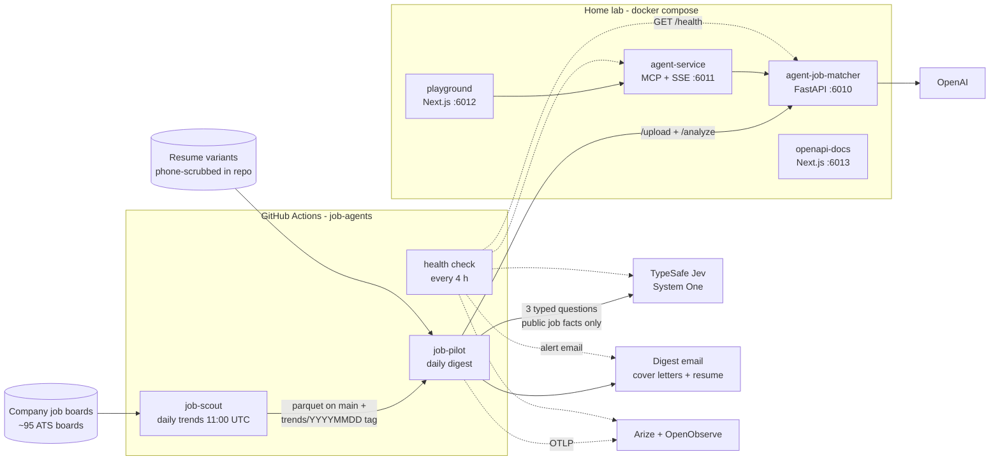
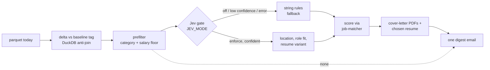

# Architecture

The whole system on one page: what runs where, who calls whom, and what is
allowed to fail.

## System view

## The six images

| Image | Project | One line |
|---|---|---|
| `job-scout` | job-scout | Scrapes ATS boards, writes the daily parquet and trends |
| `job-pilot` | job-pilot | LangGraph digest pipeline with the Jev gate |
| `agent-job-matcher` | job-matcher | FastAPI scoring service and CLI |
| `agent-job-matcher-agent-service` | job-matcher | Chat/MCP agent service over the API |
| `agent-job-matcher-playground` | job-matcher | Web GUI to try a match |
| `agent-job-matcher-openapi-docs` | job-matcher | Web GUI for the API reference |

## The daily pipeline (job-pilot)

## Where Jev sits

| | Before Jev | With Jev (`enforce`) |
|---|---|---|
| Location | hand-kept list of states and cities; unknown strings dropped | Jev `choice`: `us`, `remote_us`, `non_us`, `unclear` |
| Role fit | substring match on titles | Jev `noul` score against target families (from job-scout `config.yaml`) |
| Resume variant | first matching title substring, else master | Jev `choice` among four variants |
| Rejections | a count | each reason recorded; near-misses flagged in the digest |
| On failure | n/a | confidence below threshold or any error falls back to the rules; circuit breaker after 5 errors |

What stays deterministic code: category set, salary floor, `RUN_PAID_MATCH`,
`max_jobs_per_run`. Jev replaces the fuzzy rules only.

## Contracts and boundaries

- **job-scout → job-pilot:** a committed parquet over HTTPS plus `trends/YYYYMMDD`
  tags as baselines. Nothing is imported across project directories except
  job-scout's `config.yaml` (target roles, board slugs, salary floor), which
  job-pilot reads so the targets stay single-sourced.
- **job-pilot → job-matcher:** `/upload` and `/analyze` over HTTPS. All LLM
  calls happen in job-matcher; job-pilot is deterministic code.
- **job-pilot → Jev:** `POST /v1/systemone`, whitelisted job facts only.
- **Privacy:** public repo, so no artifacts are uploaded by the digest, resumes
  are committed with `{{PHONE}}`, and logs carry counts and reasons only.

## Failure behaviour

| What breaks | Effect | Signal |
|---|---|---|
| Jev down or key missing | rules decide; digest flagged | digest Failures box |
| job-matcher down | matching fails per job, listed as failures | health-check email, digest |
| Trace collectors down | warning only; email still sends | health-check email |
| trends publish failed | digest does not run (it chains on success) | missing digest email |

## Schedule

| When (UTC) | What |
|---|---|
| 11:00 | job-scout daily trends, then triggers job-pilot digest on success |
| 11:45 | site (Pages) refresh, `/trends/` |
| every 4 h at :17 | job-pilot health check |
| on push | tests and image builds per project |
