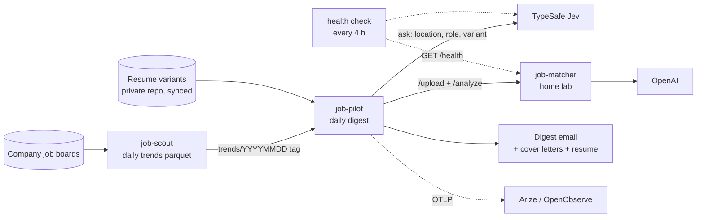

# Architecture

- **Schedule:** job-scout's trends workflow runs at 11:08 UTC and triggers the
  job-pilot digest on success.
- **Contract between projects:** job-pilot reads job-scout's committed parquet
  over HTTPS and calls job-matcher's `/upload` and `/analyze`. Nothing is
  imported across project directories except job-scout's `config.yaml`
  (target roles, board slugs), which job-pilot reads so the targets stay
  single-sourced.
- **Deployment:** the six GHCR images are built by this repo's workflows.
  The home lab pulls the four `agent-job-matcher*` images.
