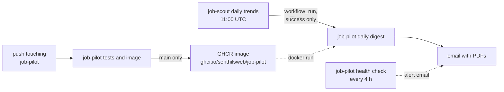

# CI/CD

At the end you will know how the two workflows chain off the daily
data publish, and the one privacy rule they must never break.

## job-pilot daily digest (`.github/workflows/job-pilot.yml`)

Triggered by the successful completion of "job-scout daily trends" —
this guarantees the fresh parquet is on `main` before the pipeline
reads it — plus manual dispatch with an optional baseline input.

Steps: resolve the baseline tag (the newest snapshot the last
successful run could have seen, walking back up to 8 days to the newest
existing `trends/` tag, and failing loudly if there is none) → `docker run` the published image with all secrets as
environment variables.

**The privacy rule: this workflow uploads no artifacts.** On a public
repository, workflow artifacts are downloadable by anyone. Job
description text, match results, and cover letters exist only on the
runner and in the sent email. Logs carry counts and error reasons only.

## job-pilot tests and image (`.github/workflows/job-pilot-image.yml`)

On every push touching `job-pilot/` (or job-scout's
`config.yaml`, which the pipeline reads): run the pytest suite — no
secrets, no network. On `main`, additionally rebuild and push the
Docker image. The image is `python:3.12-slim` with pure-Python
dependencies only; nothing apt-installed.

## job-pilot health check (`.github/workflows/job-pilot-health.yml`)

Every 4 hours (`17 */4 * * *`) and on dispatch. Runs
`.github/scripts/health_check.py`, which probes the endpoints the
pipeline depends on and emails one alert when any is down. It needs only
read access to the repository and the same SMTP secrets as the digest.
Dispatch inputs: `force_email` and `trace_probe`.

## Jev gate configuration

The digest workflow passes `JEV_MODE` (dispatch input, else the
repository variable, else `off`) and `TYPESAFE_API_KEY` to the image.
See [Jev gate](jev.md).

## Docs

This wiki is part of the umbrella site built and deployed by
`.github/workflows/site.yml` (MkDocs Material + monorepo plugin) at
`https://www.senthilsweb.com/job-agents/job-pilot/`.

Next: [FAQ](faq.md)
