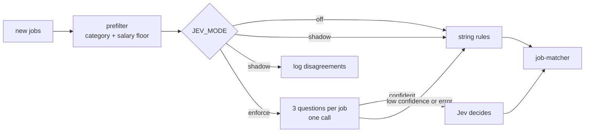

# Jev gate

At the end you will know what the Jev gate decides, how to switch it on and
off, and what it can and cannot see.

job-pilot's old rules were string heuristics for location, role and resume
variant. They failed in both directions: a good job in an unlisted city was
dropped before it was ever scored, and a title like "Forward Deployed
Engineering Manager" matched the wrong variant. The Jev gate hands those
fuzzy decisions to TypeSafe's Jev, a model that answers
typed questions (a choice, a score) with a confidence and generates no text.

## Modes

| `JEV_MODE` | Behaviour |
|---|---|
| `off` (default) | The string rules decide. No call is made. A missing `TYPESAFE_API_KEY` forces this with a warning. |
| `shadow` | Jev runs beside the rules and changes nothing. Every disagreement is logged and shown in the digest. |
| `enforce` | Jev decides location, role fit and variant when confident; otherwise the rules decide. |

Set it as the repository variable `JEV_MODE`, or per run with the
`jev_mode` input of the digest workflow. Rolling back is setting it to
`off`; no redeploy.

## The three questions

| Question | Type | Answers |
|---|---|---|
| `location` | choice | `us`, `remote_us`, `non_us`, `unclear` |
| `target_role` | noul (score) | is it one of the target role families (built from job-scout's `config.yaml`) |
| `variant` | choice | `master`, `genai-fde`, `data-genai-fde`, `eng-manager` |

All three go in one call per job.

## Decisions and fallback

| Rule | Value |
|---|---|
| Location threshold | 0.85 (`non_us` rejects; `us`, `remote_us`, `unclear` pass) |
| Role-fit threshold | 0.85 either way |
| Variant override | only at 0.70 or above, else the rule's variant |
| Below a threshold | the string rule's answer is used |
| Any error (HTTP, timeout, unparseable) | rule answer; the failure is listed in the digest |
| Circuit breaker | after 5 consecutive errors the remaining jobs skip Jev |
| Retries | 429 and 529 only, honouring `Retry-After`, up to 2 |

For `noul` answers there is no confidence field, so confidence is
`max(p, 1 - p)`.

## What Jev sees

Only these public job facts: title, department, employment type, location,
work mode and compensation summary. Never the job text, your resume, the
company name, URLs or requisition ids. A test fails the build if the request
state ever grows beyond this whitelist. The key is never logged.

## What it does not change

The category set, the salary floor, `RUN_PAID_MATCH` and
`max_jobs_per_run` stay deterministic code that runs before Jev. Jev
replaces the fuzzy rules only.

## In the digest and logs

- With the gate on, the digest gains a **Gate · Jev** section: counts, the
  jobs it rejected with reasons, and near-misses (rejected, but Jev gave at
  least a 0.30 chance to pass) so a wrong rejection is visible.
- The log line: `jev: mode=enforce asked=N calls=N errors=0 tokens=in/out cost=$… model=…`.

## Configuration

`config.yaml` → `jev:` holds the API URL, model, timeout, retries, breaker,
thresholds, near-miss floor and the question text. The model is `jev-latest`
by default; pin a version (for example `jev-1.13.0`) if you need results to
stay stable across model updates.

Spec: `openspec/changes/jev-rules-gate/`.

Next: [Configuration](configuration.md)
